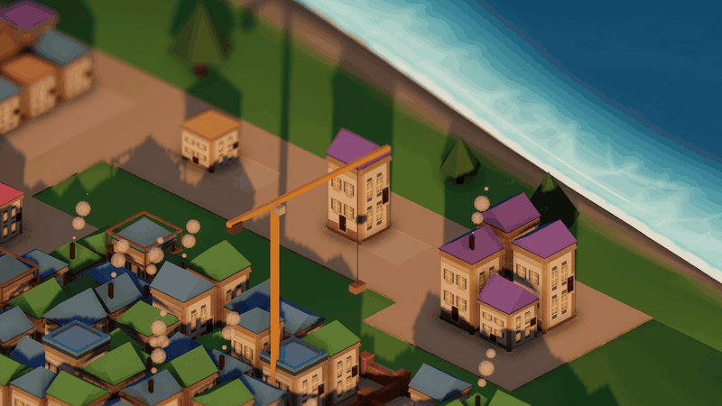
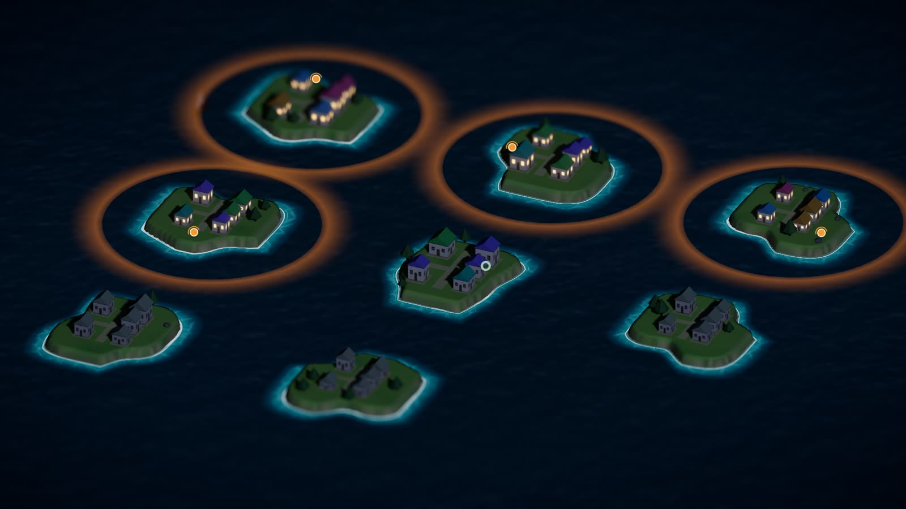
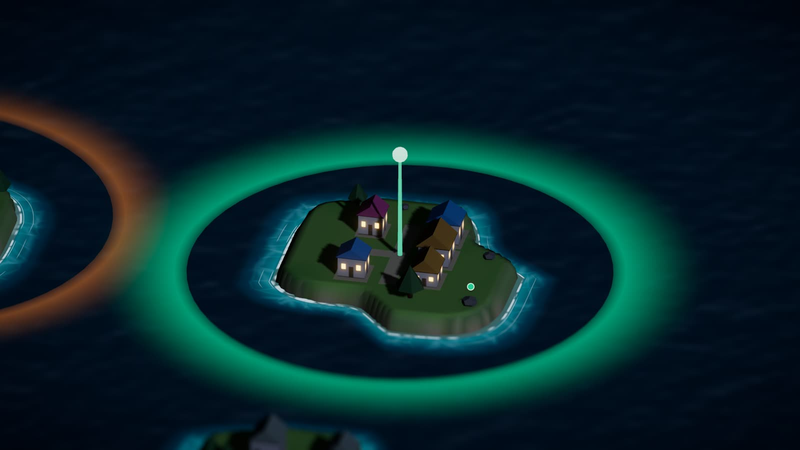
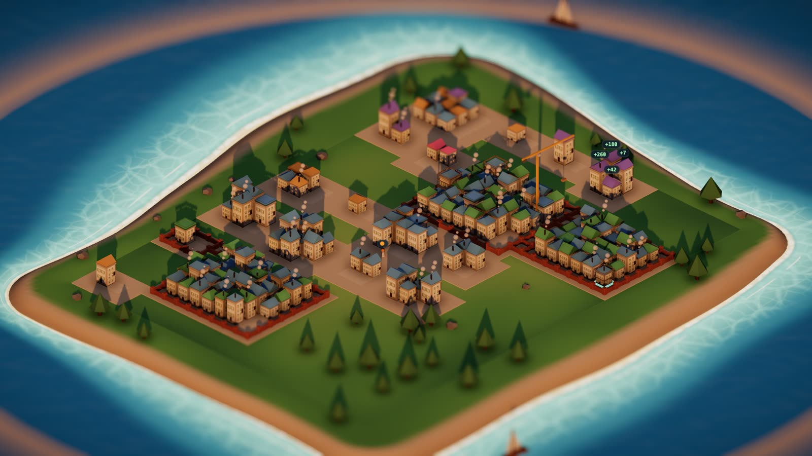
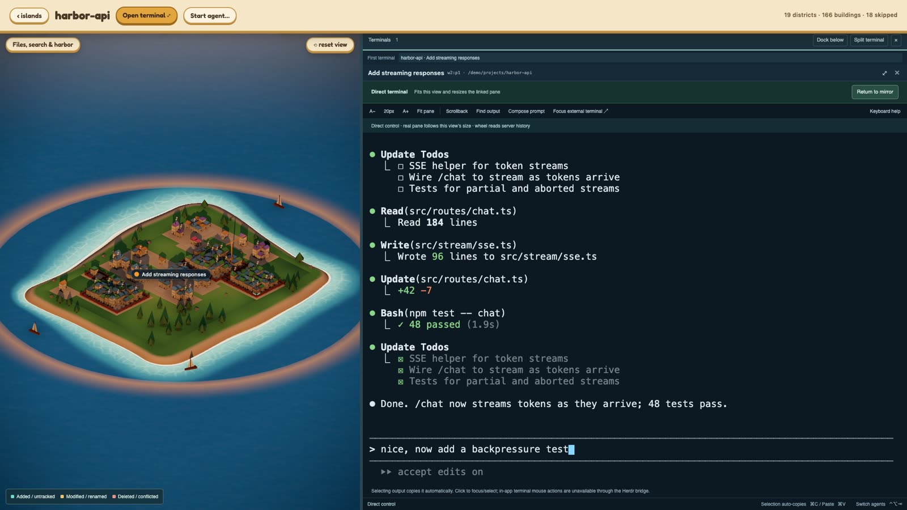
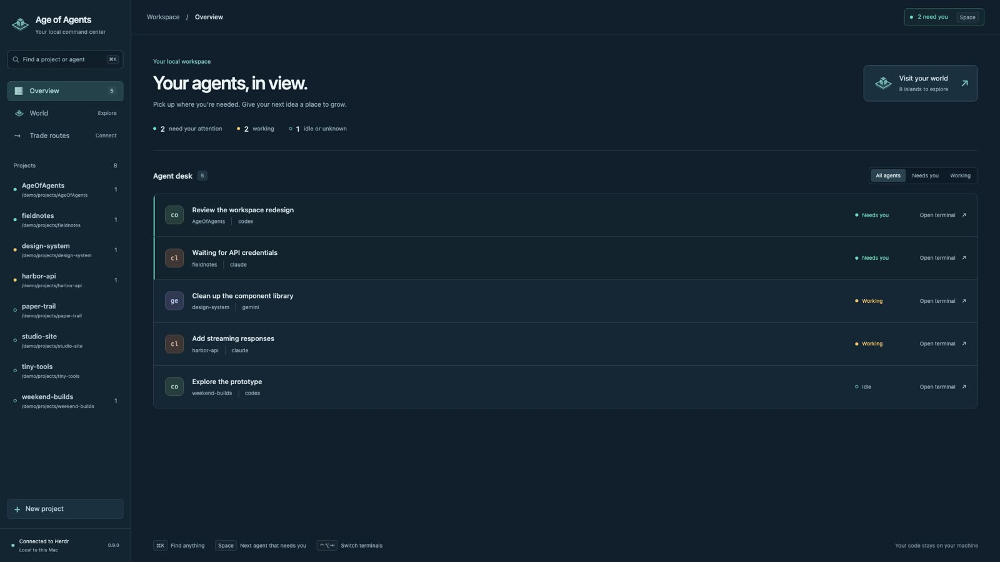
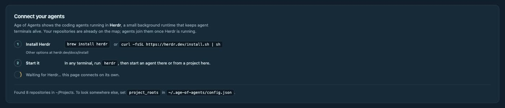

<div align="center">

# Age of Agents

**A city-builder where the cities are your git repositories<br/>and the villagers are your AI coding agents.**




</div>

---

We code with several AI agents at once, each in its own terminal tab. That
works fine: we always know what's running and what's waiting. It just isn't
much to look at.

So we made it a game. **Age of Agents** turns your machine into an archipelago:
every repository is an island, every file is a building, and every agent is a
villager you can walk up to and talk to.

<table>
<tr>
<td width="50%"></td>
<td width="50%"></td>
</tr>
<tr>
<td><sub><b>Your repos, at night.</b> Orange islands have an agent at work.</sub></td>
<td><sub><b>An agent finishes.</b> Its island turns green and the camera flies to it.</sub></td>
</tr>
</table>

## What it does

### 🏝️ Every repository is an island

Islands are sized by their real code and keep their place between sessions, so
your world stays recognisably yours. Each one glows in its agent's state:

- 🟠 **Orange**: an agent is working.
- 🟢 **Green**: an agent finished and needs you.
- ⭕ **Green ring**: finished, and you've already looked.

Press <kbd>Space</kbd> to fly to whichever agent stopped first.

### 🏠 Every file is a building



Open an island and you're in its town. Nothing here is decoration:

| In the town | In your repo |
| --- | --- |
| A building | A file |
| Its height | The file's line count |
| Its roof colour | The kind of file |
| A district | A directory |
| A wall around it | That directory has tests |
| Scaffolding and a crane | Files changed while an agent works |
| A floating **+42** | Lines that just changed |

While an agent works, the town is re-measured every few seconds. Buildings rise
as files grow, new files climb out of the ground, and changed buildings get
scaffolding and a crane. Click any building to preview the file, or search the
whole town with <kbd>⌘</kbd><kbd>⇧</kbd><kbd>F</kbd>.

### 💻 Click a villager, get its terminal



The real session opens right beside the town: type, paste, scroll, select to
copy, split two agents side by side, and switch between them with
<kbd>⌃</kbd><kbd>⌥</kbd><kbd>⇥</kbd>. It's a true mirror of the same pane you'd
see in your own terminal, not a copy.

### 📋 And a plain desk, when you just want to work



Every agent, sorted by who needs you. <kbd>⌘</kbd><kbd>K</kbd> finds any
project or agent; <kbd>Enter</kbd> opens it. Start a new agent in any repo, or
found a brand-new project, without leaving the app.

## Getting started

You need **macOS**, [Node](https://nodejs.org), [Rust](https://rustup.rs) and
[Herdr](https://herdr.dev), the small background runtime that keeps agent
terminals alive. Age of Agents reads your agents from it.

```sh
brew install herdr            # or: curl -fsSL https://herdr.dev/install.sh | sh
herdr                         # start it in any terminal

git clone https://github.com/nejcar20/age-of-agents
cd age-of-agents
npm install
npm run tauri dev
```

Haven't started Herdr yet? The app opens on your world anyway (your repos are
already on the map) and walks you through it, connecting by itself once
Herdr is up:



**Where it looks for repos.** Next to the projects your agents already run in,
plus folders like `~/Projects`, `~/code` and `~/Developer`. To choose for
yourself, list them in `~/.age-of-agents/config.json`:

```json
{ "project_roots": ["~/work", "~/side-projects"] }
```

## Keyboard

| Keys | Does |
| --- | --- |
| <kbd>⌘</kbd><kbd>K</kbd> | Find any project or agent |
| <kbd>Space</kbd> | Jump to the next agent that needs you |
| <kbd>⌃</kbd><kbd>⌥</kbd><kbd>⇥</kbd> | Switch terminals (add <kbd>⇧</kbd> to go back) |
| <kbd>⌘</kbd><kbd>⇧</kbd><kbd>F</kbd> | Search the text of every file in a town |
| <kbd>⇧</kbd><kbd>M</kbd> | Day, golden hour or night. At night, windows light up where agents are live |
| <kbd>⇧</kbd><kbd>R</kbd> | Recording mode: names and panels leave the shot and the camera orbits |

## The one rule

> **The city is honest about the code.**
> It never draws something that isn't on disk, and it never silently leaves out
> something that is.

A building you don't have is a lie; a district quietly missing is the same lie
in different clothes. Water, trees and boats are scenery and may be pretty.
Nothing decorative is ever allowed to carry information. This rule settled
nearly every design question, and nearly every bug worth fixing broke it.

Two more promises: it is **never slower than switching terminal tabs**, and
**nothing in it rewards being a worse engineer**. There are no scores, streaks
or counters that go up when you run more agents.

## Privacy and permissions

Everything runs on your machine. The app talks to Herdr over its local socket
and to nothing else: no network, no accounts, no telemetry. Everything it
stores lives in `~/.age-of-agents/`.

It's a cockpit, not an autopilot. It never writes a prompt for you, never
retries or re-sends, never answers an agent on its own, and never types
anything you didn't type. The complete list of what it may and may not do is
in the [full guide](docs/guide.md#what-the-app-is-permitted-to-do), and every
change is reviewed against it.

## How it's built

- **`src-tauri/`**: Rust, the only part that decides anything. It talks to
  Herdr, walks repositories through git, lays out towns and the archipelago,
  and owns every write.
- **`src/`**: React and three.js (via react-three-fiber). It draws what it's
  told and holds no authority over what's true.

```sh
npm test                        # frontend tests (vitest)
cd src-tauri && cargo test      # backend tests
npm run tauri build             # a .app and .dmg in src-tauri/target/release/bundle/
```

Every screenshot here comes from the built-in preview harness, which renders
the real components with sample data and needs neither Herdr nor Tauri:

```sh
npx vite --config vite.townshot.config.ts
# open /townshot.html?fixture=workspace&workspace=1
```

## Learn more

- **[The full guide](docs/guide.md)**: every feature and every limit, in detail.
- **[The design spec](docs/superpowers/specs/2026-09-16-age-of-agents-design.md)**: the principles and why.

---

<div align="center">
<sub>Built by <a href="https://github.com/nejcar20">nejcar20</a> and <a href="https://github.com/lukazlatecan">lukazlatecan</a>, for fun. MIT licensed.</sub>
</div>
